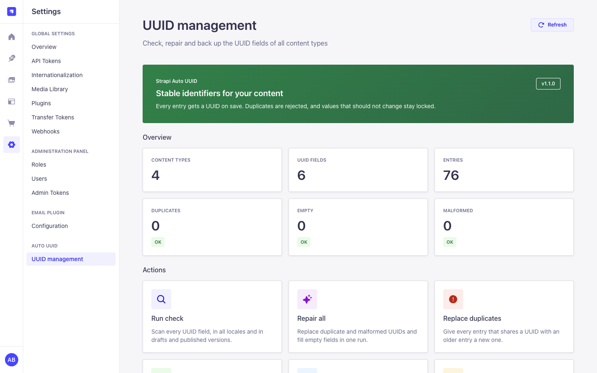
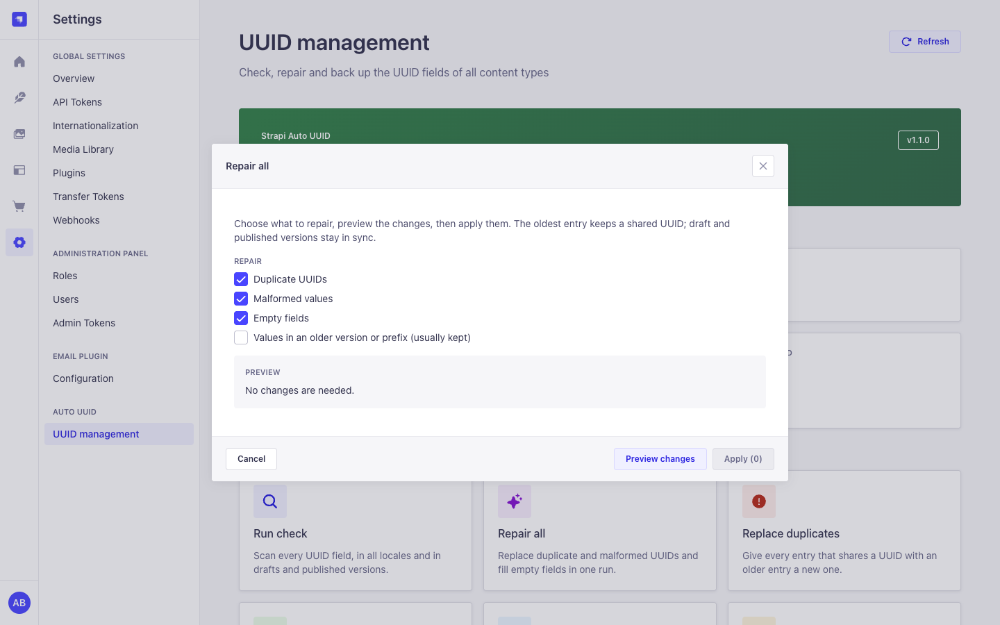
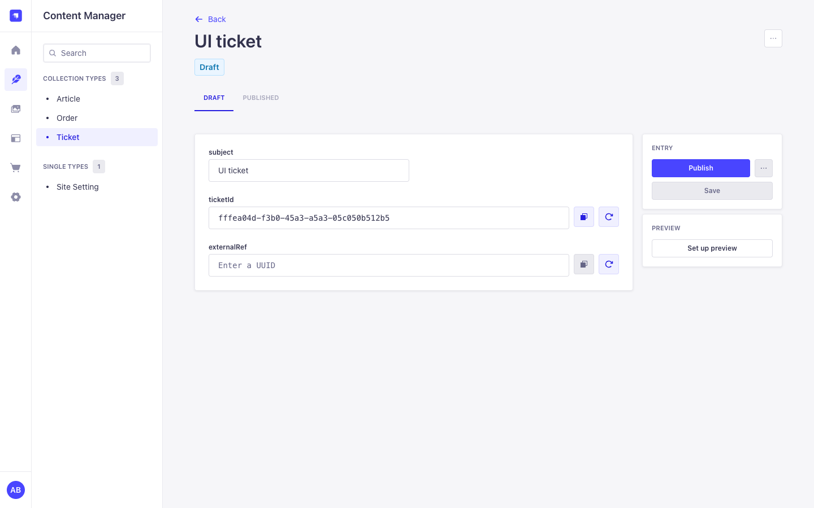
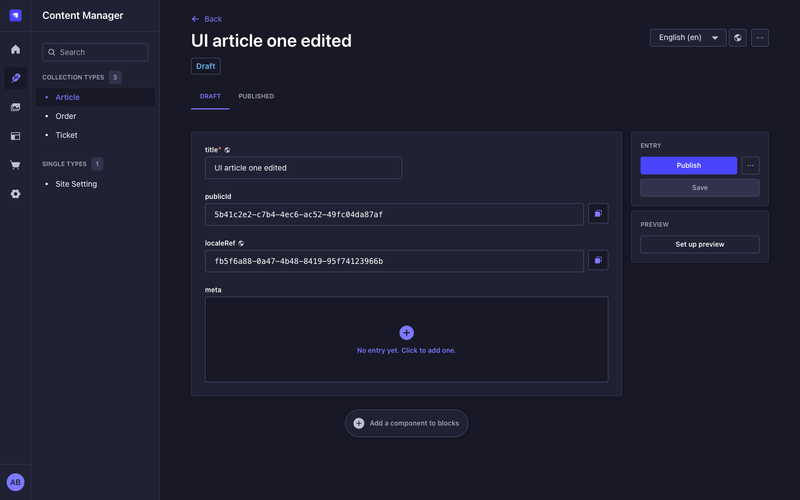
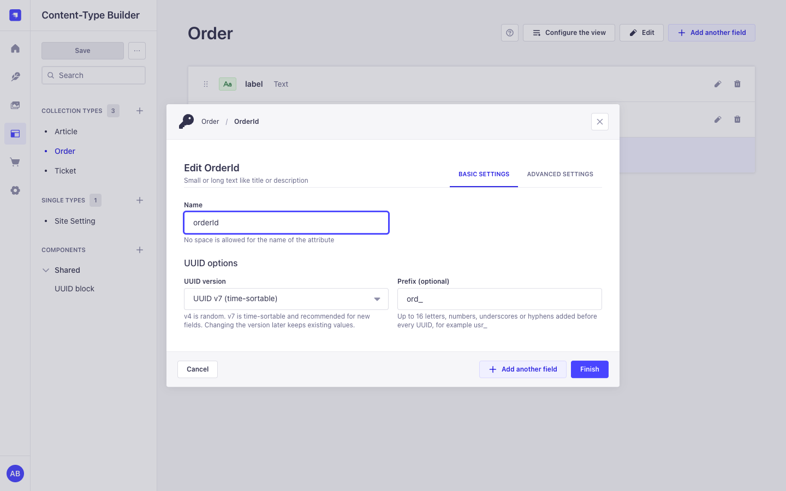
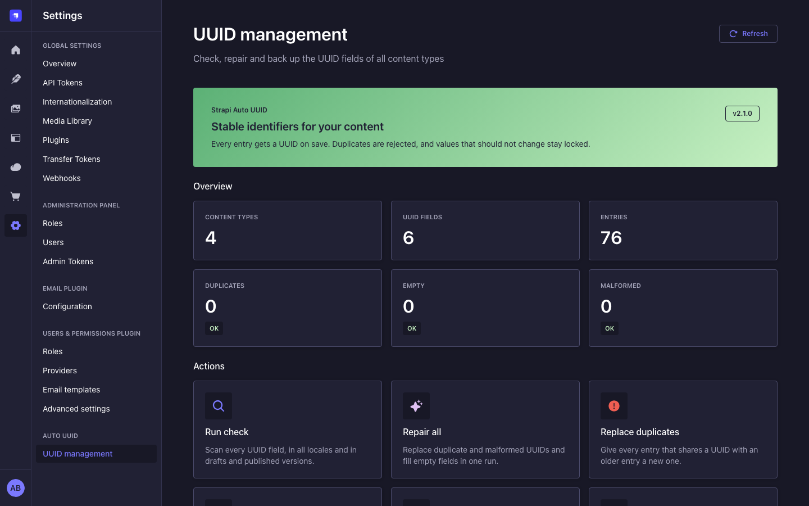
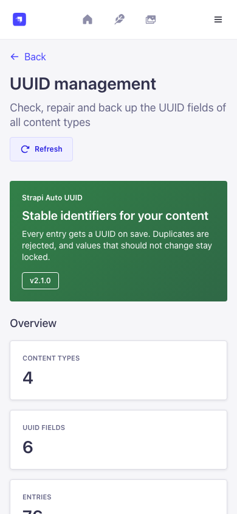
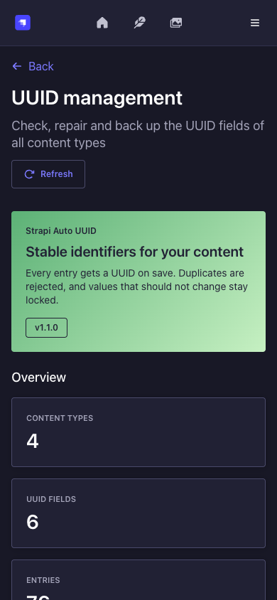

<p align="center">
  
</p>

# Auto UUID for Strapi 5

Give every Strapi 5 entry a UUID that the server generates, that no other document can reuse and that nobody changes by accident. Add the field in the Content-Type Builder, save an entry, and the value is there, whether the entry came from the admin, REST, GraphQL or the Document Service.

[](https://www.npmjs.com/package/strapi-auto-uuid-v5)
[](https://www.npmjs.com/package/strapi-auto-uuid-v5)
[](https://github.com/Schero94/strapi-auto-uuid/actions/workflows/ci.yml)
[](https://github.com/Schero94/strapi-auto-uuid/blob/main/LICENSE)
[](https://strapi.io)
[](https://schero94.github.io/strapi-auto-uuid/)

Live docs: https://schero94.github.io/strapi-auto-uuid/



```text
POST /api/tickets   { "data": { "title": "Printer offline" } }
201                 { "data": { "title": "Printer offline",
                                "ticketId": "tkt_019a5f3c-8b2e-7d41-9c3a-5e2f1b7a4d10", ... } }
```

This is the Strapi 5 continuation of [Cringe-Studio/strapi-auto-uuid](https://github.com/Cringe-Studio/strapi-auto-uuid), which supports Strapi 4 only.

## Contents

- [What you get](#what-you-get)
- [Screenshots](#screenshots)
- [Quick start](#quick-start)
- [Compatibility](#compatibility)
- [Field options](#field-options)
- [Examples](#examples)
- [How values are protected](#how-values-are-protected)
- [UUID management page](#uuid-management-page)
- [Plugin configuration](#plugin-configuration)
- [Admin API](#admin-api)
- [Permissions](#permissions)
- [Security and privacy](#security-and-privacy)
- [Performance](#performance)
- [Running several instances (Railway replicas, pm2 cluster)](#running-several-instances-railway-replicas-pm2-cluster)
- [Troubleshooting and FAQ](#troubleshooting-and-faq)
- [Upgrading](#upgrading)
- [Contributing](#contributing)
- [Maintenance, languages and license](#maintenance-languages-and-license)

## What you get

- A **UUID** custom field with UUID v4 (random) or v7 (time-sortable) and an optional prefix such as `usr_`.
- Values are generated on the server when an entry is created, so REST, GraphQL, the Document Service and the admin all get one.
- Uniqueness across documents, checked on every save, in every locale and in draft and published versions. UUIDs are compared case-insensitively (RFC 9562), and new values are stored in lowercase.
- Values are locked by default. You can allow editing per field.
- A settings page with counts per content type, a check, repairs with preview and confirmation, and export and import of all UUIDs.
- Safe with several Strapi processes on one database (Railway replicas, pm2 cluster). The database is the only shared state.
- Admin UI in English, German, French, Spanish and Portuguese, built with the Strapi Design System in light and dark mode.
- No outbound network calls, no telemetry, no license key.

## Screenshots

All screenshots use synthetic data.

| UUID management                                                                                                                                                   | Repair preview                                                                                                                                             |
| ----------------------------------------------------------------------------------------------------------------------------------------------------------------- | ---------------------------------------------------------------------------------------------------------------------------------------------------------- |
|                   |              |
| **Editable field (copy and generate)**                                                                                                                            | **Locked fields, dark mode**                                                                                                                               |
|               |  |
| **Field options in the Content-Type Builder**                                                                                                                     | **UUID management, dark mode**                                                                                                                             |
|  |                               |
| **Mobile, light**                                                                                                                                                 | **Mobile, dark**                                                                                                                                           |
|                                |             |

## Quick start

1. Install the package in your Strapi project:

   ```bash
   npm install strapi-auto-uuid-v5
   # or: yarn add strapi-auto-uuid-v5
   # or: pnpm add strapi-auto-uuid-v5
   ```

2. Enable the plugin in `config/plugins.ts` (TypeScript projects, the Strapi default):

   ```ts
   export default () => ({
     'field-uuid': {
       enabled: true,
     },
   });
   ```

   or in `config/plugins.js`:

   ```js
   module.exports = {
     'field-uuid': {
       enabled: true,
     },
   };
   ```

3. Rebuild the admin and start Strapi: `npm run build && npm run develop`.
4. In the Content-Type Builder, open a content type, choose **Add another field**, then **Custom** and **UUID**. Pick v4 or v7 and, if you want one, a prefix.
5. Save an entry. The UUID is generated on save and shown in the field.

Super Admins see **Settings > Auto UUID > UUID management** right away. Other roles need the [permissions](#permissions) below.

## Compatibility

| Plugin version | Strapi                                                                                  | Node.js                  | Database                                                                      |
| -------------- | --------------------------------------------------------------------------------------- | ------------------------ | ----------------------------------------------------------------------------- |
| 2.x            | 5.24 or newer; acceptance host: Strapi 5.61.0                                           | 22.12 or newer, up to 26 | SQLite, PostgreSQL, MySQL 8 / MariaDB. Tests run on SQLite and PostgreSQL 16. |
| 1.x            | 5.x                                                                                     | as required by Strapi    | Any database Strapi supports                                                  |
| Strapi 4       | use [Cringe-Studio/strapi-auto-uuid](https://github.com/Cringe-Studio/strapi-auto-uuid) |                          |                                                                               |

Package managers: a fresh Strapi 5.61 app installs the plugin without a single peer dependency warning from this package on Yarn 1.22, npm 11 and pnpm 12. The plugin needs nothing beyond what a Strapi app already has:

- Required peers, all in the Strapi app template: `@strapi/strapi`, `react`, `react-dom`, `react-router-dom`, `styled-components`.
- Optional peers, which Strapi installs itself: `@strapi/design-system`, `@strapi/icons`, `react-intl`.
- `@strapi/utils` is a regular dependency and resolves to the copy Strapi installs.

## Field options

Set these when you add or edit the field in the Content-Type Builder.

| Option                  | Stored in the schema as            | Default | Effect                                                                                                                                                                                                 |
| ----------------------- | ---------------------------------- | ------- | ------------------------------------------------------------------------------------------------------------------------------------------------------------------------------------------------------ |
| UUID version            | `options["uuid-version"]`          | `v4`    | `v4` is random. `v7` is time-sortable and recommended for new fields. Changing it later keeps existing values.                                                                                         |
| Prefix                  | `options["uuid-prefix"]`           | none    | 1 to 16 letters, numbers, `_` or `-`, added before the UUID (`usr_018f...`).                                                                                                                           |
| Unique values           | `unique`                           | on      | Strapi also checks uniqueness when an entry is published. This is **not** a database constraint; Strapi 5 does not create one for this option. The plugin rejects duplicates on every save either way. |
| Private field           | `private`                          | off     | The field is not returned by the API.                                                                                                                                                                  |
| Disable auto-generation | `options["disable-auto-generate"]` | off     | Editors enter the UUID themselves. Without manual editing it can be entered once and is then locked.                                                                                                   |
| Allow manual editing    | `options["allow-edit"]`            | off     | Editors and API clients can set and change the UUID. When off, the server generates the value and nobody can change it.                                                                                |

## Examples

All values below are synthetic.

### The field in a schema

The Content-Type Builder writes this into `src/api/ticket/content-types/ticket/schema.json`. You can also write it by hand:

```json
{
  "attributes": {
    "title": { "type": "string" },
    "ticketId": {
      "type": "customField",
      "customField": "plugin::field-uuid.uuid",
      "unique": true,
      "options": { "uuid-version": "v7", "uuid-prefix": "tkt_" }
    }
  }
}
```

### Create through REST

```http
POST /api/tickets
Authorization: Bearer <API token>
Content-Type: application/json

{ "data": { "title": "Printer offline" } }
```

```json
{
  "data": {
    "id": 12,
    "documentId": "k2v8q4n6x0c1m3b5z7l9p2r4",
    "title": "Printer offline",
    "ticketId": "tkt_019a5f3c-8b2e-7d41-9c3a-5e2f1b7a4d10",
    "createdAt": "2026-11-07T10:15:00.000Z",
    "updatedAt": "2026-11-07T10:15:00.000Z"
  },
  "meta": {}
}
```

Look an entry up by its UUID with a normal Strapi filter: `GET /api/tickets?filters[ticketId][$eq]=tkt_019a5f3c-8b2e-7d41-9c3a-5e2f1b7a4d10`.

### Create from server code

```js
const ticket = await strapi.documents('api::ticket.ticket').create({
  data: { title: 'Printer offline' },
});
strapi.log.info(ticket.ticketId); // tkt_019a5f3c-...
```

### A rejected write

Sending a UUID that another document already uses (on a field with **Allow manual editing** on) returns Strapi's standard error envelope:

```json
{
  "data": null,
  "error": {
    "status": 400,
    "name": "ValidationError",
    "message": "UUID already exists for field 'ticketId'. Please use a unique value.",
    "details": { "field": "ticketId", "code": "DUPLICATE_UUID" }
  }
}
```

Error codes in `error.details.code`:

| Code                        | When                                                                                              |
| --------------------------- | ------------------------------------------------------------------------------------------------- |
| `INVALID_UUID`              | The value is not a UUID of the field's version, or the prefix is missing.                         |
| `DUPLICATE_UUID`            | Another document uses the value (compared case-insensitively).                                    |
| `IMMUTABLE_UUID`            | The field does not allow manual editing and already has a value.                                  |
| `BULK_UUID_WRITE`           | An `updateMany` tries to set one UUID on several documents.                                       |
| `INVALID_UUID_FIELD_CONFIG` | The field's version or prefix option is invalid.                                                  |
| `UUID_TARGET_UNKNOWN`       | The plugin cannot find the entry an update targets, so it rejects the update instead of guessing. |

## How values are protected

| Situation                                                 | Result                                                                                                                                                           |
| --------------------------------------------------------- | ---------------------------------------------------------------------------------------------------------------------------------------------------------------- |
| Create with an empty field                                | A value is generated (unless auto-generation is off).                                                                                                            |
| Create with a value, field not editable                   | The value is replaced by a generated one.                                                                                                                        |
| Create with a value, field editable                       | Kept if it matches the version and prefix and no other document uses it; otherwise 400.                                                                          |
| Publish, discard draft, new locale                        | The document's existing value is kept.                                                                                                                           |
| Clone                                                     | The copy gets a new value. On the admin clone page the copied value is cleared: it is generated on save, or the editor enters a new one for manual-entry fields. |
| Update with the same value                                | Always accepted, even if it predates a version or prefix change.                                                                                                 |
| Update with a different value                             | Only for editable fields, or once while the field is empty. Must be valid and unused, otherwise 400.                                                             |
| Existing entry without a value                            | Filled on its next save.                                                                                                                                         |
| Value that differs from another document's only in case   | Treated as a duplicate (400). A new value sent in uppercase is stored in lowercase.                                                                              |
| Bulk `updateMany` that sets one UUID on several documents | Rejected with 400.                                                                                                                                               |

Rows of the same document (draft and published version, and the locales of a non-localized field) may share a value. Two documents may not. A localized UUID field has its own value per locale.

Saves from several processes are serialized with database locks (see [Running several instances](#running-several-instances-railway-replicas-pm2-cluster)). One gap remains: a write that runs outside a transaction (a bare `strapi.db.query().create()`) takes no lock. The Document Service, the Content Manager and the REST and GraphQL APIs always use a transaction.

UUID fields inside components and dynamic zones are filled by the admin panel when the component is shown with an empty value. The server does not generate, validate or repair them (API writes, cloned entries and duplicated components keep whatever value they carry). Use a content-type field when the value must be unique. The plugin logs a warning at startup when it finds such a field.

## UUID management page

**Settings > Auto UUID > UUID management**

- **Overview:** content types, UUID fields, entries, duplicates, empty and malformed values. Values in an older version or prefix are counted separately; they still work and are kept by default.
- **Run check:** scans every field again (one scan per click).
- **Repair all:** choose duplicates, malformed values, empty fields and (optionally) older-format values, preview the changes, then apply them after a confirmation. The oldest document keeps a shared UUID.
- **Replace duplicates** and **Generate missing UUIDs:** the same repair limited to one category. Fields with auto-generation off are never filled.
- **Export UUIDs:** downloads every UUID with its documentId and locale as compact JSON. A large export is split into several files (`...-part-1-of-3.json`) so that each one fits the import limits.
- **Import UUIDs:** fills empty fields from an export (file or pasted JSON). Existing values are never replaced.

Repairs and imports run in one database transaction and are rolled back completely if a write fails. Only one repair or import runs at a time, across all processes. For a localized UUID field every locale keeps its own value: a repair fills an empty locale with a new value (or with the value of its own draft) and never copies another locale's value. The **Entries** card counts documents, once per content type, even when a content type has several UUID fields.

## Plugin configuration

All keys are optional. Unknown keys and wrong types fail at boot with a message that names the key.

```js
module.exports = {
  'field-uuid': {
    enabled: true,
    config: {
      defaultVersion: 'v4', // version for fields without an explicit version: 'v4' | 'v7'
      autoGenerate: true, // generate values on create and for empty fields on save
      validateUniqueness: true, // reject values used by another document
      maxRetryAttempts: 3, // collision retries per generated value, integer 1-10
      autoMigrate: false, // repair empty, malformed and duplicate values on boot
      logLevel: 'info', // 'debug' | 'info' | 'warn' | 'error'
      rateLimitStore: 'auto', // 'auto' | 'database' | 'memory'
    },
  },
};
```

| Option               | Type                                     | Default  | Description                                                                                                                                                                                 |
| -------------------- | ---------------------------------------- | -------- | ------------------------------------------------------------------------------------------------------------------------------------------------------------------------------------------- |
| `defaultVersion`     | `'v4' \| 'v7'`                           | `'v4'`   | Version for fields that do not set one.                                                                                                                                                     |
| `autoGenerate`       | boolean                                  | `true`   | Generate values on create and fill empty fields on save. Per field, **Disable auto-generation** wins.                                                                                       |
| `validateUniqueness` | boolean                                  | `true`   | Reject a value that another document already uses.                                                                                                                                          |
| `maxRetryAttempts`   | integer, 1 to 10                         | `3`      | Retries when a generated value is already taken.                                                                                                                                            |
| `autoMigrate`        | boolean                                  | `false`  | Repair empty, malformed and duplicate values at startup (see below).                                                                                                                        |
| `logLevel`           | `'debug' \| 'info' \| 'warn' \| 'error'` | `'info'` | Minimum level of the plugin's log lines.                                                                                                                                                    |
| `rateLimitStore`     | `'auto' \| 'database' \| 'memory'`       | `'auto'` | Where admin rate-limit counters live. `auto`: database on PostgreSQL and MySQL, memory on SQLite. See [Running several instances](#running-several-instances-railway-replicas-pm2-cluster). |

`allowManualEdit` from 1.x is accepted but has no effect; use the per-field option. These settings are read from the config file at startup; there is no settings form for them in the admin.

### Environment variables

| Name                                        | Required | Default | Effect                                                                                        |
| ------------------------------------------- | -------- | ------- | --------------------------------------------------------------------------------------------- |
| `STRAPI_AUTO_UUID_ALLOW_PRODUCTION_MIGRATE` | no       | unset   | Set to `true` to let `autoMigrate` run when `NODE_ENV=production`. Without it, it is refused. |

`autoMigrate` writes data on every start. It never replaces older-format values. With several processes only one of them runs the repair; the others log `Boot repair skipped`.

## Admin API

All routes are admin routes under `/field-uuid` on your Strapi host (for example `GET https://cms.example.test/field-uuid/stats`). They need an admin JWT (`Authorization: Bearer <admin JWT>`) and, except `/health`, the listed permission. The plugin has no Content API routes. Write endpoints default to a preview: send `"dryRun": false` to write.

| Method and path          | Permission          | Limit per admin and minute | Body                                                              | Response                                                                 |
| ------------------------ | ------------------- | -------------------------- | ----------------------------------------------------------------- | ------------------------------------------------------------------------ |
| `GET /health`            | authenticated admin | none                       |                                                                   | `{ status: 'ok', plugin: 'field-uuid' }`                                 |
| `GET /stats`             | `read`              | 20                         |                                                                   | Counts, per-field counts, UUID fields per content type                   |
| `GET /models`            | `read`              | none                       |                                                                   | `{ models: { uid: [field] } }`                                           |
| `GET /diagnose`          | `read`              | 5                          |                                                                   | Counts per field, no values                                              |
| `GET /migration/status`  | `read`              | 10                         |                                                                   | Counts per field, no values                                              |
| `POST /autofix`          | `migrate`           | 5                          | `{ dryRun? }`                                                     | Replace duplicates                                                       |
| `POST /generate-missing` | `migrate`           | 5                          | `{ dryRun? }`                                                     | Fill empty fields                                                        |
| `POST /migration/run`    | `migrate`           | 3                          | `{ dryRun?, fixEmpty?, fixInvalid?, fixDuplicates?, fixLegacy? }` | Repair result. At least one option must be true.                         |
| `GET /migration/export`  | `export`            | 3                          |                                                                   | JSON attachment with all mappings                                        |
| `POST /migration/import` | `import`            | 3                          | `{ mappings, dryRun? }`                                           | Import result. At most 10,000 entries, 100 content types, 20 fields each |

Status codes: 400 for an invalid body, 401 without a valid admin JWT, 403 without the permission, 409 `REPAIR_IN_PROGRESS` while another repair or import runs on any instance, 429 when the limit is reached. Diagnostic and repair responses never contain documentIds or UUID values; only the export does. With `rateLimitStore: 'database'` (the default on PostgreSQL and MySQL) the limits hold across all instances.

### Example: preview, then run a repair

```http
POST /field-uuid/migration/run
Authorization: Bearer <admin JWT>
Content-Type: application/json

{ "fixEmpty": true, "fixDuplicates": true, "fixInvalid": true }
```

Without `"dryRun": false` this is a preview and writes nothing:

```json
{
  "dryRun": true,
  "startedAt": "2026-11-07T10:20:00.000Z",
  "fixed": { "empty": 3, "invalid": 0, "legacy": 0, "duplicates": 1 },
  "skipped": 0,
  "skippedChanges": [],
  "errors": [],
  "totalFixed": 4,
  "completedAt": "2026-11-07T10:20:00.041Z"
}
```

Send the same body with `"dryRun": false` to apply it. If a field cannot be scanned, the run stops before writing (`"aborted": true` with `errors[].code`). A failed write rolls everything back (`"failed": true, "rolledBack": true`).

### Example: export and import

The export is a JSON document you can keep as a backup:

```json
{
  "exportedAt": "2026-11-07T10:25:00.000Z",
  "format": 2,
  "mappings": {
    "api::ticket.ticket": {
      "fields": {
        "ticketId": [
          {
            "documentId": "k2v8q4n6x0c1m3b5z7l9p2r4",
            "uuid": "tkt_019a5f3c-8b2e-7d41-9c3a-5e2f1b7a4d10"
          },
          {
            "documentId": "p7d1w3e5r9t2y4u6i8o0a1s3",
            "uuid": "tkt_019a5f3d-1c4a-7e22-8b51-0d9e3f6a2c87",
            "locale": "de"
          }
        ]
      }
    }
  }
}
```

To restore it into empty fields, send the whole export document as `mappings`:

```http
POST /field-uuid/migration/import
Authorization: Bearer <admin JWT>
Content-Type: application/json

{ "mappings": { "exportedAt": "...", "format": 2, "mappings": { "api::ticket.ticket": { "fields": { "ticketId": [ ... ] } } } }, "dryRun": false }
```

The response has `imported`, `skipped`, `unchanged`, `errorCounts` (per code) and up to 20 `errors` samples. An import body must also fit Strapi's JSON body limit (`jsonLimit` of the `strapi::body` middleware, 1 MB by default), which holds roughly 9,000 to 11,000 entries depending on prefix and locale. The admin export already splits files to fit both limits.

## Permissions

**Settings > Administration Panel > Roles > Plugins > Auto UUID.** Super Admins have all four. Give other roles only what they need.

| Action UID                   | Label in the role editor                                                  | Allows                                                                                              |
| ---------------------------- | ------------------------------------------------------------------------- | --------------------------------------------------------------------------------------------------- |
| `plugin::field-uuid.read`    | Read UUID status and diagnostics                                          | The settings page, counts and the check (`/stats`, `/models`, `/diagnose`, `/migration/status`)     |
| `plugin::field-uuid.migrate` | Repair UUIDs (replace duplicates and malformed values, fill empty fields) | Repairs (`/autofix`, `/generate-missing`, `/migration/run`)                                         |
| `plugin::field-uuid.export`  | Export all UUID mappings of every content type                            | Download every documentId and UUID of every content type, regardless of Content Manager permissions |
| `plugin::field-uuid.import`  | Import UUID mappings into empty fields                                    | Fill empty UUID fields from a file                                                                  |

The settings link and each button are shown only to roles that have the permission, and every route checks the permission again on the server. Editing the field in the Content Manager follows your normal Content Manager permissions. The plugin adds no Users & Permissions (Content API) permissions.

## Security and privacy

- Every admin route checks authentication and the plugin permission on the server. Request bodies are validated with strict zod schemas; unknown keys are rejected.
- Errors never contain stack traces, database errors or stored values. Logs contain the admin id for repairs, exports and imports (an audit line) but no values, IP addresses or request bodies.
- Export holders see every documentId and UUID of every content type. The export is not filtered by Content Manager permissions, so grant it like a backup permission.
- There is no database unique constraint: the draft, published and locale rows of one document share a value, so a plain unique index is not possible (see [Performance](#performance) for an optional lookup index). Concurrent writes from several processes are serialized with transaction-scoped database locks instead.
- Rate-limit rows use SHA-256 hashes as keys. No admin id or IP address is stored.
- The plugin makes no outbound network requests. It has no telemetry, no analytics and no license or activation check. Everything it stores lives in your database: the UUID values in your own tables, plus the plugin tables `field_uuid_rate_limits` and (MySQL only) `field_uuid_locks`.
- Report security issues privately through [GitHub security advisories](https://github.com/Schero94/strapi-auto-uuid/security/advisories/new).

## Performance

- Each save runs a few lookups per UUID field (`select id ... where field = ? limit 1`). Without an index each one scans the table, so the cost grows with the number of rows.
- Checks, repairs and exports read rows in pages of 5,000 by primary key and only select `id`, `documentId`, `locale`, `publishedAt` and the UUID column. No relations are populated.
- Imports look up targets and conflicts in batches of 500 entries (two queries per batch), then write one `updateMany` per imported value.
- Measured on SQLite with about 5,000 synthetic tickets: the overview scan answered in 40 ms, a 5,000-value import preview took 64 ms and the import itself 315 ms.

For large tables, add an index on each UUID column with a [Strapi database migration](https://docs.strapi.io/cms/database-migrations). Strapi runs these files once, before its schema sync, and keeps indexes it did not create. Add the migration after the column exists (the migration skips a missing table or column and does not run again):

```js
// database/migrations/2026.11.07T00.00.00.uuid-indexes.js
'use strict';

// [table, column] pairs: the snake_case names Strapi uses in the database.
const INDEXES = [
  ['tickets', 'ticket_id'],
  ['articles', 'public_id'],
];

async function up(knex) {
  for (const [table, column] of INDEXES) {
    if (!(await knex.schema.hasTable(table)) || !(await knex.schema.hasColumn(table, column))) {
      continue;
    }
    await knex.schema.alterTable(table, (t) => t.index([column], `${table}_${column}_uuid_idx`));
  }
}

module.exports = { up };
```

The test suite runs this code on SQLite and checks that the lookup changes from `SCAN` to `SEARCH ... USING INDEX`.

## Running several instances (Railway replicas, pm2 cluster)

The plugin is safe when several Strapi processes share one database, for example 2 Railway replicas that each run 4 pm2 cluster workers (8 Node processes, no sticky sessions). The database is the only shared state; Redis or any other service is not needed.

### Requirements for several instances

- **Database**: PostgreSQL (recommended; tested with 8 processes on PostgreSQL 16) or MySQL 8 / MariaDB with InnoDB (supported, not yet tested live). All processes must use the same database and schema.
- **Table permission**: the database user must be allowed to create tables in that schema at startup (`field_uuid_rate_limits`, and `field_uuid_locks` on MySQL). Strapi's own schema sync needs the same right. If a table cannot be created, the plugin logs a warning (`Rate-limit table unavailable` or `Could not prepare the lock table`) and falls back to per-process counters or locks, which do not hold across processes.
- **Connections**: every process opens its own pool; see the pool sizing note under [Configuration](#configuration).
- **SQLite**: one process only. Several processes on one SQLite file are not supported by Strapi.
- **Redis**: optional and not used by this plugin. Counters and locks live in the database, so adding Redis changes nothing for Auto UUID.
- **Sticky sessions**: not needed. Any process can serve any request. Only the list of UUID fields and their options is read per process at startup (see [Rolling deploys](#rolling-deploys-and-schema-changes)).

What is shared between the processes, and how:

| Concern                                                                 | Mechanism                                                                                                                                                                   |
| ----------------------------------------------------------------------- | --------------------------------------------------------------------------------------------------------------------------------------------------------------------------- |
| Two processes save the same client-supplied UUID                        | Before the uniqueness check, the save takes a lock on that value for the rest of its transaction. The second save waits, then sees the first and gets 400 `DUPLICATE_UUID`. |
| Two processes fill the same empty, non-editable field                   | The save locks that field of the document and reads the row again. The second save sees the stored value and gets 400 `IMMUTABLE_UUID`.                                     |
| Repair or import started on two processes (also two clicks)             | The repair transaction takes a repair lock without waiting. The other process answers 409 `REPAIR_IN_PROGRESS`.                                                             |
| `autoMigrate` on every booting process                                  | Same repair lock: one process repairs, the others log `Boot repair skipped` and continue starting.                                                                          |
| An editor changes a row between the repair's scan and its write         | Every repair and import write is guarded by the expected old value. A write that matches no row is not counted and is reported as skipped (`CONCURRENT_CHANGE`).            |
| An editor fills an empty write-once field while a repair or import runs | The repair or import holds a write lock until it commits; such a save waits for it, then sees the stored value and gets 400 `IMMUTABLE_UUID` instead of overwriting it.     |
| Admin rate limits (`/migration/run`, export, import, ...)               | One counter per admin and route in the table `field_uuid_rate_limits`, incremented with one atomic upsert, so the limit holds across all processes.                         |

Locks are transaction-scoped and released by the database on commit, rollback or a lost connection, so a crashed worker never leaves one behind:

- **PostgreSQL** (recommended): advisory locks (`pg_advisory_xact_lock`, `pg_advisory_xact_lock_shared`, `pg_try_advisory_xact_lock`). No extra table.
- **MySQL 8 / MariaDB** (not tested live yet): row locks (`SELECT ... FOR UPDATE [NOWAIT]`, `LOCK IN SHARE MODE`) on the plugin table `field_uuid_locks` (2,050 small rows, created at startup). Reads after a lock use `FOR UPDATE`, because MySQL's default REPEATABLE READ would otherwise return an older snapshot. Add the [lookup index](#performance) on each UUID column so these reads lock only matching rows.
- **SQLite**: one writer per file, so writes are already serialized. Running several processes on one SQLite file is not supported by Strapi; use one process.

Values are hashed into 1,024 lock buckets per kind, so a large import holds at most 1,024 locks. Server-generated random values take no lock. Writes that run outside a transaction (a bare `strapi.db.query().create()`) take no lock either; the Document Service, the Content Manager and the REST and GraphQL APIs always use a transaction.

The plugin creates two tables at startup when they are missing: `field_uuid_rate_limits` (PostgreSQL and MySQL, or SQLite with `rateLimitStore: 'database'`) and `field_uuid_locks` (MySQL only). Strapi's schema sync leaves tables it did not create alone. Rows expired for more than an hour are deleted on later requests.

### Configuration

Railway service variables (each replica):

```bash
DATABASE_CLIENT=postgres
DATABASE_URL=${{Postgres.DATABASE_URL}}
NODE_ENV=production
# Optional: only if autoMigrate should run on boot in production.
# STRAPI_AUTO_UUID_ALLOW_PRODUCTION_MIGRATE=true
```

`config/plugins.js`:

```js
module.exports = {
  'field-uuid': {
    enabled: true,
    config: {
      rateLimitStore: 'auto', // 'database' on PostgreSQL and MySQL
      autoMigrate: false, // recommended: run repairs from the admin page instead
    },
  },
};
```

pm2 cluster mode needs a JavaScript entry point ([Strapi pm2 guide](https://docs.strapi.io/cms/deployment/guides/pm2)):

```js
// server.js
const strapi = require('@strapi/strapi');
strapi.createStrapi({ distDir: './dist' }).start(); // distDir for TypeScript projects
```

```js
// ecosystem.config.js
module.exports = {
  apps: [
    {
      name: 'strapi',
      script: './server.js',
      exec_mode: 'cluster',
      instances: 4,
      env: { NODE_ENV: 'production' },
    },
  ],
};
```

Size the database pool for all processes: `processes x pool max` (for example 8 x 10 = 80 with Strapi's default `pool.max`) must stay below the PostgreSQL `max_connections` of your plan, or lower `pool.max` in `config/database.js`.

### Rolling deploys and schema changes

Each process reads the UUID fields and their options once at startup. During a rolling deploy, old and new replicas run side by side: until every replica runs the new code, old ones do not generate or validate a newly added UUID field and apply the old field options. Nothing is lost (empty values are filled on the next save or by a repair, older-format values are kept). After a deploy that adds a UUID field or changes its options, wait until every replica is up, then run **Check** and **Repair all** (or **Generate missing**) once from the admin page.

### Verify it

`npm run test:concurrency` starts 8 Node processes against one database and races the cases above. Run it against PostgreSQL with `AUTO_UUID_PG_URL=postgres://user@host:5432/db npm run test:concurrency -- --client postgres`.

## Troubleshooting and FAQ

| Symptom                                                            | Cause                                                                | Fix                                                                                                                       |
| ------------------------------------------------------------------ | -------------------------------------------------------------------- | ------------------------------------------------------------------------------------------------------------------------- |
| The UUID field is missing in the Content-Type Builder              | Wrong plugin key, or the admin was not rebuilt                       | Use the key `field-uuid` and run `npm run build`.                                                                         |
| Startup fails with `Invalid plugin configuration at '...'`         | Unknown key or wrong type in `config/plugins`                        | Fix the named key; see [Plugin configuration](#plugin-configuration).                                                     |
| 400 `IMMUTABLE_UUID`: "UUID field '...' is immutable"              | The field does not allow manual editing                              | Turn on **Allow manual editing** if editors or API clients must change it.                                                |
| A value sent on create was replaced                                | Manual editing is off, so the server generates the value             | Turn on **Allow manual editing** for fields that clients fill.                                                            |
| 400 `DUPLICATE_UUID`                                               | Another document uses the value, possibly in other letter case       | Send a new value, or leave the field empty so the server generates one.                                                   |
| "Entity could not be cloned" when using Duplicate in the list view | Strapi refuses its quick clone for any attribute with `unique: true` | Open the entry and use the clone page, or turn off **Unique values** (the plugin still rejects duplicates on every save). |
| The Import dialog says the file is larger than 1 MB                | Strapi's JSON body limit                                             | Export again. The export is split into files that each fit one import. Import the parts one after another.                |
| 409 "Another UUID repair or import is already running"             | A repair or import runs on this or another instance                  | Wait until it has finished, then retry.                                                                                   |
| 429 "Too many requests. Please slow down."                         | Per-admin limit (see [Admin API](#admin-api))                        | Wait a minute.                                                                                                            |
| No **Auto UUID** entry under Settings                              | The role lacks `plugin::field-uuid.read`                             | Grant it in the role editor.                                                                                              |
| Log line `Rate-limit table unavailable`                            | The database user cannot create the plugin table                     | Grant create-table rights. On a single instance, per-process counters are fine.                                           |

**Does the plugin manage UUID fields inside components?** Only in the admin: an empty one is filled when the component is shown. The server does not generate, validate or repair them.

**Values are reported as "older version or prefix". Is that a problem?** No. The field's version or prefix was changed after those values were written, and they keep working. Replace them with **Repair all** and the older-format option only if no integration depends on them.

**Can I sort by a v7 UUID?** v7 values start with a millisecond timestamp, so sorting by the column follows creation time to the millisecond. Use `createdAt` when you need an exact order.

**Do I need Redis for several instances?** No. Locks and counters live in the database.

**Does the plugin send anything to a server?** No. It makes no network requests and has no license check.

## Upgrading

### From 2.0 to 2.1

No route, response or config changes. With several processes on one database:

1. The database user needs permission to create tables at startup (as for Strapi's own schema sync).
2. Size the connection pool for all processes (`processes x pool.max` below the database's `max_connections`).

### From 1.x to 2.x

Version 2.0.0 is a major release because some write rules are stricter:

1. Node.js 22.12 or newer and Strapi 5.24 or newer are required.
2. Fields with **Allow manual editing** off are generated on the server only. A value sent on create is replaced. API clients that send their own UUIDs need **Allow manual editing** on for that field.
3. A create that sends a UUID another document already uses is rejected with 400 `DUPLICATE_UUID`. This includes the same UUID in different letter case.
4. `POST /field-uuid/check-duplicate` was removed (the admin never used it). `POST /field-uuid/migration/import` no longer accepts `overwrite: true` and takes at most 10,000 entries.
5. Unknown plugin config keys fail at boot. `allowManualEdit` is still accepted and still has no effect.
6. The Content Manager no longer shows a UUID on the create form; the value appears after the first save.

After upgrading, open **Settings > Auto UUID > UUID management**, run the check and export a backup before you use **Repair all**.

### From Strapi 4

1. Rename the plugin key in `config/plugins.js` from `strapi-auto-uuid` to `field-uuid`.
2. Start Strapi, open **Settings > Auto UUID > UUID management** and run the check.
3. Export the UUIDs as a backup, then use **Repair all** with the preview if duplicates or empty fields are reported.

Existing values are kept: the field type changed from `uid` to `string`, which does not alter the stored data.

## Contributing

Bug reports and pull requests are welcome.

- [Open an issue](https://github.com/Schero94/strapi-auto-uuid/issues/new) with your Strapi, Node.js and database versions and the steps to reproduce. Please use synthetic data.
- [Browse open issues](https://github.com/Schero94/strapi-auto-uuid/issues) and [pull requests](https://github.com/Schero94/strapi-auto-uuid/pulls).
- Report security problems through [GitHub security advisories](https://github.com/Schero94/strapi-auto-uuid/security/advisories/new), not in public issues.

Local setup and checks:

```bash
npm ci --legacy-peer-deps
npm run lint              # ESLint 10 flat config
npm run format:check      # Prettier
npm test                  # Vitest, including lifecycle and repair tests on a real SQLite database
                          # (set AUTO_UUID_PG_URL to also run the PostgreSQL tests)
npm run test:concurrency  # 8 processes on one database (SQLite, or PostgreSQL with --client postgres)
npm run build             # strapi-plugin build + bundle checks (externals, chunk size)
npm run verify            # strapi-plugin verify
```

Use [Conventional Commits](https://www.conventionalcommits.org/): `fix:` makes a patch release, `feat:` a minor one, and a `BREAKING CHANGE:` footer a major one. Add your change to the `[Unreleased]` section of the [CHANGELOG](https://github.com/Schero94/strapi-auto-uuid/blob/main/CHANGELOG.md). Pull requests run lint, format check, tests, build and package checks on Node.js 22 and 24, plus the PostgreSQL and 8-process tests.

## Maintenance, languages and license

The plugin is actively maintained for Strapi 5. semantic-release publishes releases from `main` with npm provenance; see the [CHANGELOG](https://github.com/Schero94/strapi-auto-uuid/blob/main/CHANGELOG.md) and [GitHub releases](https://github.com/Schero94/strapi-auto-uuid/releases). Dependabot proposes dependency updates every week.

Admin languages: English, German, French, Spanish and Portuguese.

MIT, see [LICENSE](https://github.com/Schero94/strapi-auto-uuid/blob/main/LICENSE). Originally created by [Cringe Studio](https://github.com/Cringe-Studio).
